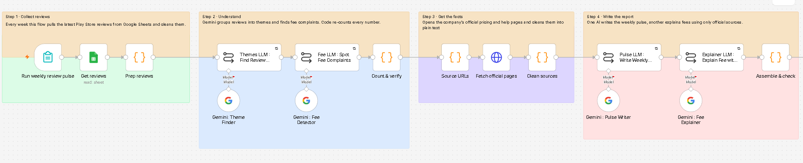
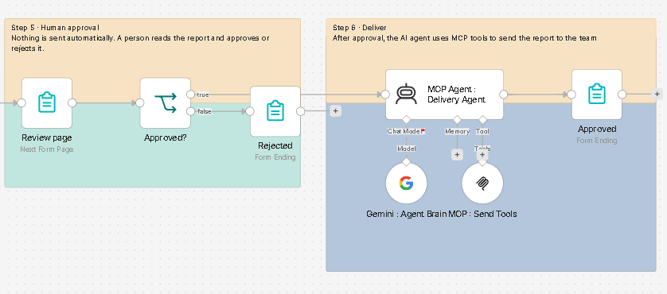
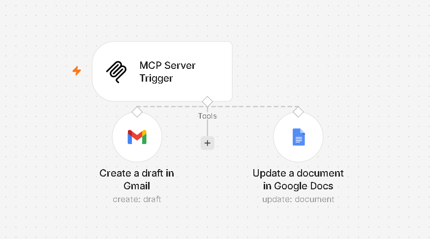

# Groww Weekly Review Pulse · n8n + Gemini + MCP

An n8n workflow that turns Groww's Google Play Store reviews into a **weekly product pulse** and a **fact-checked fee explainer**, with a human approval step before anything is saved or drafted.

---

## The problem

App reviews show exactly how users feel, but nobody has time to read thousands of them every week. And when users are confused about fees, support teams often give inconsistent answers.

## How it works

| Step | Nodes | What happens |
|---|---|---|
| 📥 **1. Collect** | Run weekly review pulse → Get reviews → Prep reviews | A form starts the run. Reviews are pulled from Google Sheets and cleaned. |
| 🧠 **2. Understand** | Themes LLM → Fee LLM → Count & verify | Gemini groups reviews into themes and extracts fee complaints. Code recounts every number so stats come from real counts, not AI estimates. |
| 🔎 **3. Get the facts** | Source URLs → Fetch official pages → Clean sources | Fetches Groww's official pricing and help pages and cleans them into plain text. The fee explainer can only use these sources. |
| ✍️ **4. Write** | Pulse LLM → Explainer LLM → Assemble & check | One model writes the weekly pulse (themes, real quotes, 3 actions). Another writes the fee explainer. Code validates the output. |
| 🙋 **5. Human approval** | Review page → Approved? → Rejected | A reviewer reads the draft and approves or rejects it. |
| 🚀 **6. Deliver** | MCP Agent → Approved | An AI agent uses MCP tools to append the report to a Google Doc and create a Gmail draft. Email is never sent automatically. |

### MCP Server (second workflow)

Exposes two tools to the agent: **Create a draft in Gmail** and **Update a document in Google Docs**.

## Sample output (run on 19 Oct 2026)

**Window:** 18 Sep to 16 Oct 2026 · 949 reviews, 600 sampled

**Top themes**
1. Clean and intuitive interface for beginner investing: 43%
2. Order execution slippage, chart lags and server downtime: 19%
3. High brokerage and unexpected transaction charges: 10%

**Fee issue found:** DP charges. Users thought they were charged on every partial order. They are actually charged only on sell transactions, per stock per day.

**Action ideas**
1. Fix server downtime, chart lags and stop-loss execution errors.
2. Show a clear fee breakdown (brokerage, DP charges, DDPI fees) before a trade is placed.
3. Keep the beginner-friendly UI while improving backend stability during market hours.

## Files

| File | What it is |
|---|---|
| `groww-review-pulse.json` | Main workflow |
| `mcp-server-tools.json` | MCP Server workflow with the Gmail and Google Docs tools |
| `workflow-part1.png`, `workflow-part2.png` | Screenshots of the main workflow |
| `mcp-server.png` | Screenshot of the MCP Server workflow |

## Setup

1. In n8n, import both JSON files (**⋯ → Import from File**).
2. Add your credentials: Google Sheets, Google Docs, Gmail and Google Gemini (PaLM) API.
3. **Get reviews:** replace `YOUR_GOOGLE_SHEET_ID` with your sheet of reviews.
4. **Update a document in Google Docs:** replace `YOUR_GOOGLE_DOC_ID` with your doc.
5. **Create a draft in Gmail:** replace `your-email@example.com` with the draft recipient.
6. Activate the MCP Server workflow, copy its production URL, and paste it into the **MCP : Send Tools** node (replacing `https://YOUR-N8N-INSTANCE/mcp/YOUR_MCP_PATH`).
7. Open the **Run weekly review pulse** form and start a run.

## Safety by design

- **Code checks the numbers.** Theme shares are recomputed in code, not trusted from the model.
- **Fee answers use only official pages.** The explainer can't answer from the model's memory.
- **A human approves every report.** Nothing is saved or drafted without approval.
- **Drafts only.** The agent can create Gmail drafts but never sends email.

## Tech stack

n8n · Google Gemini · MCP · Google Sheets · Google Docs · Gmail

## What I learned

- Small, focused LLM steps work better than one giant prompt.
- Letting code check the AI's numbers mattered more than any prompt tweak.
- Grounding answers in official sources makes fee explanations trustworthy.
- Human approval and limited agent permissions make automation safe to use.

---

**Author:** Vedanshi Tiwari · [LinkedIn](https://www.linkedin.com/in/YOUR-PROFILE)
